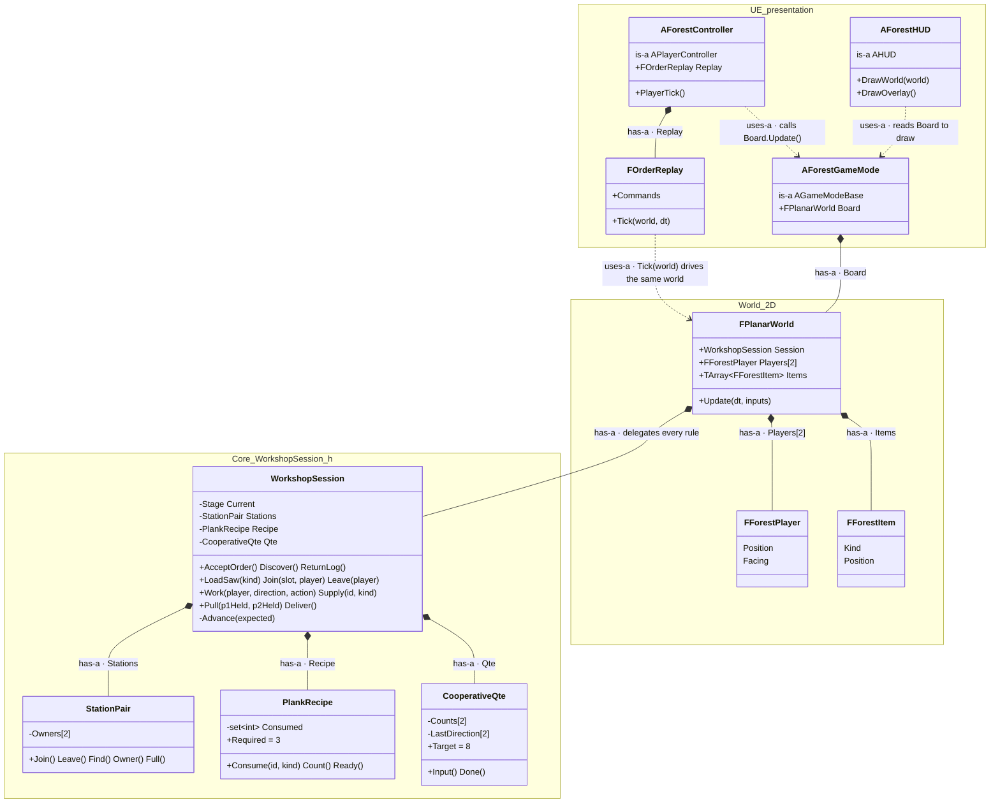
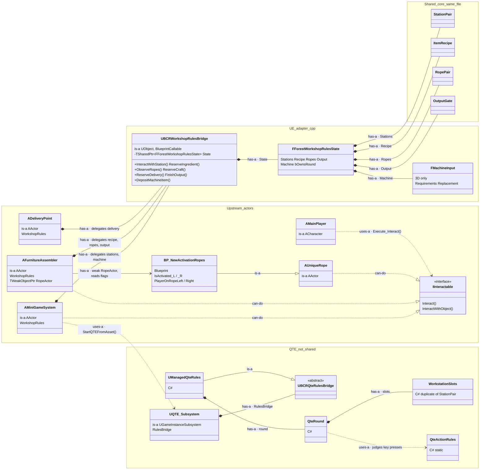

# Route B：2D → 3D 比较、Class Map、变化图与 CCR

> 复算：在仓库根目录运行 `powershell -ExecutionPolicy Bypass -File docs/route-b/ccr.ps1`
> 3D 重建与验证步骤：[重建、构建与运行](../forest-3d/README.md)

## 开发顺序（如实说明）

0. **先构思并实现 3D game flow**。以《双人成行》和《胡闹厨房》的双人协作为玩法参考，先实现接单、双人取材与搬运、分工锯木、投放三段木料、双绳组装及交付摇椅。本地重建的 3D 工程所用关卡、角色和美术来自固定的 Project Becorn 版本。[Project Becorn / Oakfolks](https://github.com/LeoSery/Project-Becorn--UnrealEngine5-2024/tree/d35718cfe66854e0a9b40ea06d44e4ce4fa44b1f)
1. **早期 3D 适配（3D 成员）**：独立 2D 版出现前，在上游工程上做 UE 5.8 兼容、共享键盘和 UnrealSharp C# 规则迁移。工坊规则当时写在 `WorkshopRules.cs` 与 `ManagedWorkshopRules.cs` 中。
2. **2D 基线（2D 成员，AI 辅助）**：2026-11-12 新建独立 UE 2D 工程 `forest-2d/`。规则集中在 `Domain/WorkshopSession.h`，不依赖 UE。该版本冻结为 `2d-baseline`，随后只做可用性迭代 `2d-v1.1`。
3. **Route B 集成（2D 成员，AI 辅助，本轮）**：让 3D 成员 的 3D 工坊**编译并使用 2D 的规则文件**，替换 C# 工坊规则。为此，2D 核心加入了 3D 需要、而 2D 原来没有的规则（见 CCR 一节）。
   中间曾另写过一个独立的 `forest-3d/` 工程（只用基本形状）。它不是 3D 成员 的 3D，已按要求放弃，以普通提交删除。

小组先实现 3D game flow，再冻结独立可玩的 2D 版，最后将共享规则接入 `3d-final`。早期 3D 对话发生在当前 AI 工作区之外。课程老师已确认可以按这一顺序提交 Route B。

## 共享了什么、没有共享什么

| 规则 | 2D | 3D 成员 3D（集成前，C#） | 3D 成员 3D（集成后） |
| --- | --- | --- | --- |
| 两人工位占用 | `Forest::StationPair` | `WorkstationSlots` | **共享 `StationPair`**（锯台/树桩工位） |
| 配方：类型、去重、同时投料预留、失败释放 | `PlankRecipe`（只计木板） | `WorkshopRecipe` | **共享 `ItemRecipe`**；2D 的 `PlankRecipe` 也改为它的一个实例 |
| 拉绳：两名不同玩家拉动；持有人变化即失效 | `WorkshopSession::Pull` 内联判断 | `RopeRules` | **共享 `RopePair`**；2D 的 `Pull` 也改用它 |
| 产出/交付只成功一次，失败可重试 | 无（2D 生成不会失败） | `SpawnGate` | **共享 `OutputGate`** |
| 机器投料箱（替换木料、遗失恢复）与机器轮次归属 | 无 | `MachineInputRules`、`MachineRunRules` | 移入 C++ 适配器（`FMachineInput` 与轮次标记），只属于 3D |
| 订单阶段状态机 | `WorkshopSession` | 上游任务资产 + C# `QuestProgress` | 未共享 |
| 双人 QTE 节奏 | `CooperativeQte` | C# `QteActionRules` / `QteRound` | 未共享（3D QTE 有计时、超时、进度等 2D 没有的规则） |
| 移动、拾取、键盘策略 | 2D 适配器 | C# `PlayerActionRules`、`KeyboardInputPolicy` | 未变，仍为 C# |

共享的是**工坊规则**：工位、配方、拉绳和产出。3D 的 QTE 轮次 `QteRound` 内部仍有一份 C# `WorkstationSlots`，与 `StationPair` 语义重复，列为下一步。

## Class Map · 2D（交付版 `2d-v1.1`）

图件：[`forest-2d-class-map.svg`](../docs/diagrams/forest-2d-class-map.svg)（报告第 3 页，由 `docs/report/build_report.py` 生成）。

画法按课件《Class Relationships》：has-a = 字段，uses-a = 参数或一次调用，is-a = 冒号继承，can-do = 实现接口；每条线都写关系和动词。UE 引擎基类按课件的写法标在类名下，不单独画框。



`2d-v1.1` 没有接口：每条规则只有一个实现，表现层直接持有具体类，没有需要替换实现的地方。拉绳在 `WorkshopSession::Pull` 里直接检查两人都拉住。

到 `3d-final`，核心为 3D 新增 `ItemRecipe`、`RopePair`、`OutputGate`：`PlankRecipe` 改为内含一个 `ItemRecipe`（字段 `Planks`），`WorkshopSession` 多一个字段 `Ropes : RopePair`，`Pull` 改为交给它判断；2D 表现层不变。`OutputGate` 在 2D 没有调用者（2D 生成物品不会失败），由 2D 测试 `Forest2D.Rules.SharedRecipeRopesOutput` 覆盖。

## Class Map · 3D（3D 成员 的工坊，`3d-final`；只画与工坊规则相关的类）

图件：[`forest-3d-workshop-class-map.svg`](../docs/diagrams/forest-3d-workshop-class-map.svg)（报告第 4 页）。



拉绳的真实路径：组装器不读 `AUniqueRope` 的字段。它在场景里按类名找到蓝图绳 `BP_NewActivationRopes_C`，存为弱引用 `RopeActor`，用反射读 `IsActivated_L`/`_R`、`OneTimeInteract_L`/`_R` 和 `PlayerOnRopeLeft`/`Right`，再调用桥接的 `ObserveRopes`/`ReserveCraft`，由共享的 `RopePair` 判断。`UQTE_Subsystem` 运行时按类名找到 C# 子类 `UManagedQteRules` 作为 `RulesBridge`。玩家、键盘、任务等其余 3D 类见 [Class Map 图表](diagrams/)。

## 变化图

| 位置 | 改动 | 类型 | 原因 |
| --- | --- | --- | --- |
| `forest-2d/.../Domain/WorkshopSession.h` | 新增 `ItemRecipe`、`RopePair`、`OutputGate`；`PlankRecipe` 改为包一个 `ItemRecipe`；`Pull` 改用 `RopePair` | **核心扩展** | 3D 有 2D 没有的规则：多种材料、同时投料的预留、消耗失败释放、产出失败重试、拉绳持有人变化即失效。这些规则只在核心写一次，两边共用。 |
| `forest-2d/.../Tests/SharedRulesTests.cpp` | 新测试 `Forest2D.Rules.SharedRecipeRopesOutput` | 新增 | 在 2D 工程里锁住新增规则的合同。2D 测试由 3 个增加到 4 个，`Tools/Verify.ps1` 同步修改。 |
| `forest-ue-assignment/Source/BCR/BCR.Build.cs` | 加入共享规则 include 路径（环境变量 `FOREST_SHARED_RULES`，或 `SharedRules/` 目录联接）；找不到 `WorkshopSession.h` 时构建直接失败 | 新增 | 3D 编译 2D 的同一个文件，不复制。 |
| `UBCRWorkshopRulesBridge`（.h/.cpp） | 由“C# 子类实现的抽象事件”改为具体的 C++ 类，内部调用共享规则；方法签名不变 | **替换实现** | 调用方 `AMiniGameSystem`、`AFurnitureAssembler`、`ADeliveryPoint` 不需要改接口。 |
| `MiniGameSystem.cpp`（在 c13 补丁中） | 玩家编号由 `GetUniqueID()` 改为本地玩家序号 0/1 | 适配（3 行） | `StationPair` 只接受两名本地玩家。 |
| `Sources/Test/SharedWorkshopRulesTests.cpp` | 新 UE 测试 `BCR.SharedRules.Workshop` | 新增 | 把原 C# 工坊测试的场景移植到共享规则上。 |
| `Script/ManagedBCR/ManagedWorkshopRules.cs` | 删除 | 删除 | C# 工坊规则不再使用。 |
| `Script/ManagedBCR/WorkshopRules.cs` | 只保留 `WorkstationSlots`（QTE 仍在用） | 删减 | 同上。 |
| `tests/ManagedRules/Program.cs` | 去掉 27 项工坊检查（124 → 97） | 删减 | 这些场景已由 UE 测试覆盖。 |
| `patches/route-b/`、`tools/Rebuild-3D.ps1` | 从公开材料重建 3D 工程的补丁与脚本 | 新增 | 见 ROUTE_B_3D.md。 |

Route B 集成没有改动 2D 表现层（`FPlanarWorld`、HUD、控制器、回放），2D 回放仍为 75 步、零瞬移。脚本列出的 `ForestController` / `ForestHUD` 改动来自 `2d-baseline...2d-v1.1` 之间的菜单演示与退出修正，与 3D 无关。

## Core Change Ratio（CCR）

**定义**：核心 = `2d-baseline` 中 `forest-2d/Source/Forest2D/Domain/` 下的全部文件。

```
CCR = (核心文件在 2d-baseline...3d-final 之间新增行 + 删除行) / 2d-baseline 时核心文件总行数
```

**结果**：核心文件 1 个，共 134 行；变化为 +99 / −7，**CCR = 106 / 134 ≈ 79.1%**。

**这个数字怎么读**：

- 新增的 99 行几乎全是**新规则**：`ItemRecipe` 约 38 行，`RopePair` 与 `OutputGate` 各约 20 行，其余是 `#include` 和注释。
- 原有的 134 行中只删改了 7 行：`PlankRecipe` 内部改用 `ItemRecipe`，`Pull` 改用 `RopePair`，再加头部注释。改动既有行的比例约为 7 / 134 ≈ 5.2%。
- CCR 偏高，是因为 2D 设计时只覆盖了 2D 需要的规则，而 3D 成员 的 3D 早有更复杂的工坊规则；共享就意味着把这些规则搬进核心。
  - 只看“为 3D 打开并修改的既有规则”，改动很小，OCP 基本成立。
  - 看核心整体的变化，则接近八成。
  - 两种读法都如实写在这里。
- 另一种做法是核心不动，让 3D 继续用自己的 C# 规则。那样 CCR = 0%，但 2D 与 3D 不共享任何规则代码，不符合本次要求。

## 设计取舍与 SOLID

- **SRP**：每个共享类只管一件事。
  - `ItemRecipe`：配方的预留与消耗。
  - `RopePair`：两根绳的持有人与拉动状态。
  - `OutputGate`：产出只成功一次。
  - `FMachineInput`（投料箱的替换与遗失恢复）只在 3D 用到，所以留在 3D 适配器中，没有放进共享核心。
- **OCP**：3D 调用方的接口不变（桥接类方法签名不变），只替换了实现。
- **DIP**：共享核心不依赖 UE，UE 适配器依赖核心。每条规则只有一个实现，所以没有给核心另加抽象接口。
- **LSP / ISP**：UE 适配部分沿用上游 Actor 的继承关系，没有新增自定义继承层次。
- **已知取舍 / 下一步**：
  - QTE 轮次中的 C# `WorkstationSlots` 与 `StationPair` 重复。
  - 3D 回放报告里，个别检查名仍写着 “C# machine recipe / managed recipe”。这些检查实际调用的已是共享 C++ 规则；名称沿用 3D 成员 的原文，没有改。
  - 3D 的订单状态和 QTE 节奏没有与 2D 共享。

## 验证（2026-11-12，本机 UE 5.8.1）

| 项 | 结果 | 证据 |
| --- | --- | --- |
| 2D 自动测试 | 4 / 4 通过（含新增的共享规则测试） | [`forest-2d/Evidence/shared-rules/`](../forest-2d/Evidence/shared-rules/) |
| 2D 完整订单回放 | 75 步、零瞬移、通过 | 同上 |
| 3D UE 测试 `BCR.SharedRules.Workshop` | 通过 | 课程提交包中的 3D 验证记录 |
| 3D 工坊运行回放（3D 成员 的 `-BCRWorkshopSmoke`） | 集成前 17 / 17，集成后 17 / 17 | 同上（`before-shared-rules/` 与 `workshop-runtime.json`） |
| 3D 视口/键盘回放 `-BCRPlayerRulesSmoke` | 43 / 43 | 同上 |
| 3D 任务回放 `-BCRQuestSmoke` | 25 / 25 | 同上 |
| 3D C# 规则测试 `tests/ManagedRules` | 97 / 97 | 本地运行 |

3D 的三项运行回放都在导入双语提示资源（`BecornBilingual` 插件）之后运行。导入之前，视口回放为 41 / 43，任务回放未通过。失败项都是“原始双语资源存在”一类检查，与工坊规则无关。

自动回放使用的是正常的移动与交互输入，不能代替两位成员用实体键盘联合试玩。该项仍需人工完成并记录。
