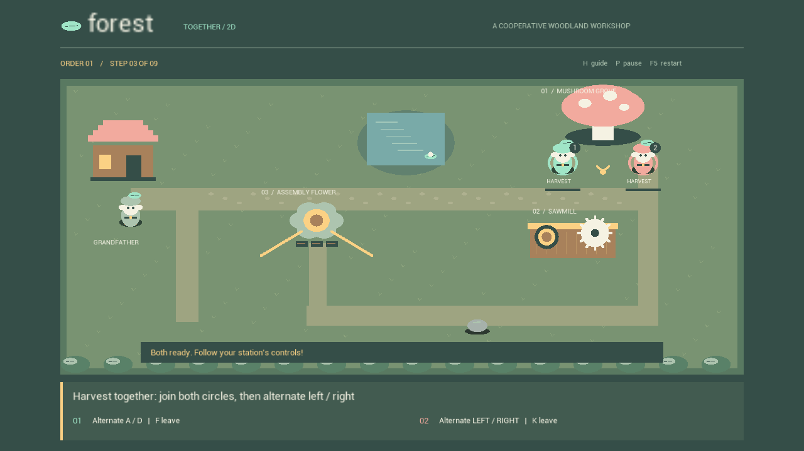

# forest together · 2D

UE 5.8.1 双人同屏合作工坊游戏。两位玩家共用键盘，为爷爷制作并交付摇椅。



## 运行

打开 `Forest2D.uproject`，需要编译时选择编译，打开 `/Game/Maps/Forest`，点击 Play，再点击游戏视口取得键盘焦点。按 Enter 开始。编辑器需要 UE 5.8.1、Visual Studio C++ 工具链与 Windows SDK。

若使用 Windows 打包版，解压整个目录后运行根目录 `Forest2D.exe`，不要只复制单个 exe。画面按 1440 × 900 设计，随窗口等比缩放。

| 操作 | 玩家 1 | 玩家 2 |
| --- | --- | --- |
| 移动 / 锯木转轮 | WASD | 方向键 |
| 拾取 / 放下 | E | J |
| 交互 / 进入或退出工位 | F | K |
| 锯木刀位 / 拉绳 | Space | 右 Shift |

共享键：Enter 开始或通关后重玩；H 操作说明；P / Esc 暂停与恢复；F5 从头重置。失去窗口焦点会暂停，切回后按 P 继续。帮助页关闭后保留此前的暂停状态。

## 从接单到交付

1. 靠近左侧爷爷，用 F / K 接单。
2. 前往右上方大蘑菇，发现取材点。
3. 两人各站一个圆圈，按 F / K 就位。P1 交替 A、D，P2 交替左、右，各完成 8 次有效方向输入。单人不能开始。
4. 用 E / J 拾起原木，带到右下锯木机。
5. 持有原木并靠近机器，按 F / K 投料。
6. 两人分别进入转轮、刀位。转轮使用不同方向输入；刀位反复按对应玩家的动作键。各完成 8 次后产出三段木料。角色可以退出工位、交换分工。
7. 将三段木料分别搬到中央组装花附近，用 E / J 放下。只有有效且未使用过的木段才计数。
8. 两人各进一侧绳位，同时按住 Space 和右 Shift，生成包裹。
9. 拾起包裹带回爷爷附近，自动交付，显示结局。Enter 再玩。

灰色石头是可拾取的错误材料，用于演示拒绝无效投料。没有总分或全局计时败局；显示的时间仅用于回顾游玩时长。没有跳跃机制，因为此版本是平面游戏。

## 实现边界

这是实际的二维游戏：世界位置使用二维坐标；移动与障碍碰撞在平面上计算；UE Canvas 绘制人物、道具、工坊和界面。没有把旧 3D 地图切换成正交相机，也没有用隐藏的 3D 物理冒充 2D。

当前使用 UE 原生 C++。`Domain/WorkshopSession.h` 不依赖 UE、坐标、按键和绘制，可以由后续 3D 适配器使用。它与仓库中的 ManagedBCR C# 是不同实现，不声称已经复用了相同源文件。桌面参考工程缺少该托管插件，因此本版本不依赖 UnrealSharp。

保留既有游戏的九步订单、双人工位、三段木材配方、双绳与一次性交付。2D 的 QTE 目标明确设置为每侧 8 次；原 3D 资产的具体时序、动画、跳台和物理表现没有宣称完全一致。未来对比必须分别说明这些适配差异。

本 2D 版本是在已有 3D 参考工程之后新建，Git 提交按实际顺序记录。此目录不改变此前开发历史。

## 结构

| 类 | 职责 |
| --- | --- |
| `WorkshopSession` | 订单阶段、合法动作、最终交付 |
| `StationPair` | 两名不同玩家的工位所有权 |
| `CooperativeQte` | 输入进度与双人完成条件 |
| `PlankRecipe` | 三段有效木料及去重 |
| `FPlanarWorld` | 二维移动、碰撞、物件生命周期与空间交互 |
| `AForestController` | 键盘分流、菜单、暂停与失焦 |
| `AForestHUD` | 二维画面、状态提示、说明和结局 |
| `AForestGameMode` | 组装世界、控制器和绘制入口 |

类之间采用组合。规则不调用界面；控制器不实现配方；绘制不改变游戏状态。没有为满足清单而增加空接口或不成立的继承关系。

## 构建与验证

`Tools/Verify.ps1` 提供 Build、Tests、Replay 和 Package 四种操作。传入安装的 UE 路径，例如：

```powershell
./Tools/Verify.ps1 -Action Build -EngineRoot E:/UE_5.8
./Tools/Verify.ps1 -Action Tests -EngineRoot E:/UE_5.8
./Tools/Verify.ps1 -Action Replay -EngineRoot E:/UE_5.8
./Tools/Verify.ps1 -Action Package -EngineRoot E:/UE_5.8 -Archive C:/Forest2D-Build
```

自动回放的 `-ForestReplay` 是测试入口：通过移动、拾放、工位与动作输入完成任务，不瞬移、不注入道具、不直接跳任务。它绕过物理键盘和窗口焦点，因此不能替代两个人的实体键盘验收。截图和可公开的测试结果见 `Evidence/`；实机按键同时输入还受键盘冲突限制。

图形由此工程中的 Canvas 代码绘制，无需下载外部美术。字体来自 UE 自带引擎字体。本项目需遵守 Unreal Engine 的使用许可。
